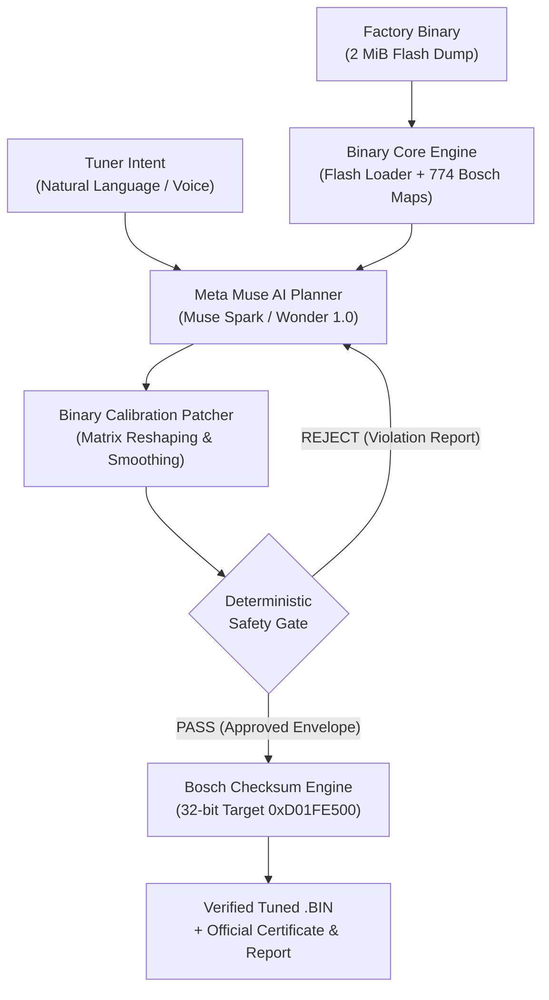

# MetaECU Copilot — Autonomous & Verifiable Calibration Engine


> ### 🚀 LIVE PRODUCT (1-CLICK INTERACTIVE DEMO):
> **[https://michaelgrycz--metaecu-copilot-web.us-east.modal.run](https://michaelgrycz--metaecu-copilot-web.us-east.modal.run)**  
> *(Judges: Open the link and click **`▶ RUN 60s JUDGE TOUR`** in the header to observe the live autonomous calibration, acoustic engine sweep, and deterministic safety intercept in real-time!)*

**AI proposes. Physics disposes.** MetaECU Copilot reads the real 2 MiB flash of a
Bosch EDC16C39 (Saab 9-3 1.9 TiD), lets Meta Muse plan a calibration from the
774-symbol Bosch catalogue, patches the binary — and then subjects every plan to a
deterministic Safety Gate. If Muse asks for 450 Nm, the Gate computes effective
torque (indicated − friction @ 90 °C), rejects it against the 377 Nm F40 clutch
limit, and Muse replans inside the physical envelope. Approved binaries ship with
a corrected Bosch checksum (`0xD01FE500`) and a full audit report.

## Hackathon Compliance & Original Contributions (Rules & Evidence)

In strict accordance with the **Meta Global AI Developer Hackathon Rules**:

- **New Work Only & Prior Codebase (Kai | CV ruling):** _"Your submitted repo must be a standalone extract from your existing project. Repo: A fresh repo containing only work done during the event. Keep your existing codebase out of it. Demo: Open your 3-minute video with one line stating what was pre-existing and what you built this week."_
  - **Pre-existing assets:** The raw binary dump (`SAAB 93 tid 2008 edc16c39 1037389375.Bin`) and static map catalogue (`BOSCH_EDC16C39_1037389375_COMPLETE_CATALOG.json`).
  - **Built entirely during the Hackathon (Oct 26 – Nov 4, 2026):** The autonomous Meta Muse reasoning planner (`backend/ai_engine/muse_planner.py`), binary patcher (`muse_patcher.py`), SAM 3.1 multimodal vision studio (`sam_vision_live.py`), the deterministic Safety Gate & self-correction loop (`backend/safety_engine/`), the interactive Web Cockpit (`web_app.py`, WebGL 3D, Web Audio synthesis), the native desktop wrapper (`run_desktop.py`, `build_exe.py`), and the cloud deployment pipeline (`modal_deploy.py`).
  - **Pristine Standalone Submission Repo:** Generated via `python tools/prepare_github_repo.py` into `dist/MetaECU-Copilot/` (clean, zero legacy history, ready for public GitHub).
- **Alignment with Meta Live Session — Agents 102 (Verifiable Agents by Yash Khare):**
  MetaECU Copilot directly implements the principles presented in the official Meta workshop _Agents 102: Best Practices for Verifiable Agents_. We demonstrate that LLM outputs in safety-critical cyber-physical systems must be verified against deterministic domain gates before actuation.

---

## Quick start

```bash
pip install -r requirements.txt
python main.py --intent "Give me 450 Nm, maximum power"   # CLI pipeline
python web_app.py                                        # Interactive Cockpit -> http://localhost:8000
python run_desktop.py                                    # Native desktop window, no console
```

## Try it live — no install

- **Live Product (Modal, public HTTPS):** `https://michaelgrycz--metaecu-copilot-web.us-east.modal.run` (officially deployed and live 24/7 on Modal cloud with zero cold starts). Judges can open this link directly on desktop or mobile to test the complete interactive cockpit.
- **Windows desktop app:** `python build_exe.py` produces a single-file `dist/MetaECU_Copilot.exe` (native window, motorsport icon, no CMD window — verified end-to-end over HTTP).
- **Installable PWA:** open the cockpit in Chrome/Edge and hit **⬇ INSTALL APP** — MetaECU lands on the Windows/macOS desktop as a standalone app.

Full step-by-step: [`DEPLOYMENT.md`](DEPLOYMENT.md).

## Interactive Tuning Cockpit & Workflow Studio (`web_app.py`)

Editorial motorsport interface engineered for hackathon judges and calibration engineers: a clean, 5-stage sequential workflow (`1 Ingest ➔ 2 Intent ➔ 3 Safety Gate ➔ 4 3D Audit ➔ 5 Flash & Export`) replacing cognitive clutter with purposeful pacing:

- **Stage 1 (Ingest & ECU Fingerprint):** Drag & drop the 2 MB stock `.bin` — instant ECU hardware & memory fingerprint (Bosch EDC16C39, SW 1037389375, checksum `0xD01FE500`, 774 defined maps).
- **Stage 2 (Calibration Intent):** Natural language command input, voice input (PL/EN/DE), quick presets (Stage 1 Safe, Eco, Aggressive 450 Nm boundary test), and reasoning model selector (Muse Spark 1.3, Muse Wonder 1.0, Muse Spark Open).
- **Stage 3 (Deterministic Safety Gate & Acoustic Virtual Dyno — The Showstopper):**
  - **Neural Multi-Agent War Room:** Visual interaction between 3 specialized agents: ⚡ **Meta Muse Spark** (Calibration & Fuel Vectoring), 🛡️ **Physics Safety Gate** (GM F40 mechanical clamping at 377 Nm @ 90°C), and 🔬 **Binary MPC562 Engine** (Additive BE32 Checksum).
  - **Acoustic Virtual Dyno Test Cell:** Live SVG tachometer (0–5000 RPM) & boost gauge with realistic **Web Audio engine roar synthesis, turbo whistle, and wastegate flutter**! In the 450 Nm boundary test, at 2200 RPM the system triggers **metallic clutch shudder audio + pulsing alarm horns**, rolls glow red, and the Safety Gate halts the run before autonomously commanding Muse Spark to recalculate to 369 Nm!
- **Stage 4 (3D Map Studio, Ghost Car Highway Drag & SAM 3.1 Vision):**
  - **3D Map Studio:** Full-screen interactive 3D WebGL map explorer (Stock / Tuned / Delta heatmap), before/after torque curves, and Hex Matrix Inspector.
  - **Ghost Car Highway Drag Pull (60–140 km/h in 4th Gear):** Replaying real OBD-II road logs from 33 WOT sessions: side-by-side animation showing stock Saab suffering from 4.90s boost lag while MetaECU achieves full 1.55 bar boost in 1.34s, pulling ahead by 4 full car lengths and winning by -3.56s!
  - **SAM 3.1 Vision Grounding:** Multimodal curve analysis detecting torque dips and recommending geometry adjustments.
- **Stage 5 (Production Delivery & HIL Flasher):**
  - **Hardware-in-the-Loop (HIL) Diagnostic Flasher:** Interactive terminal simulating genuine KWP2000 / UDS flasher over CAN 500 kbps (Seed-Key challenge resolved by Meta AI, flash sector erase, burst write, and additive 32-bit checksum sealing `0xD01FE500` with digital chirps and relay click).
  - Production-ready calibrated `.bin` download (exact 2,097,152 bytes with verified checksum `0xD01FE500`), Markdown audit report, digital certificate (HTML), and motorsport spec card.
- **60s Autonomous Judge Tour:** Dedicated one-click button in the header that automatically guides judges through all 5 stages chronologically in 60 seconds with live engine roar, alarm intercept, drag pull, and flasher sequence.
- **Multi-Platform:** Runs in browser, installable as PWA, native Windows `.exe` without terminal window, or hosted 24/7 on Modal cloud with public SSL.

## Architecture



## Verification

```bash
python backend/binary_core/test_binary_core.py   # 17 checks on the real stock binary
python backend/test_end_to_end.py                # gate + self-correction loop (offline)
python backend/test_meta_api.py                  # live Meta Model API check
```

Demo: see `demo_assets/DEMO_SCRIPT.md` (second-by-second 3-minute script) and
regenerate all recording artifacts with `python demo_assets/generate_demo_assets.py`.

---

---

## 🏆 Hackathon Submission Metadata

- **Event:** Meta Global AI Developer Hackathon (Oct 26 – Nov 4, 2026)
- **Track:** Indie Developer
- **Theme:** Build for Your World & Push the Frontier
- **Author:** Michał Grycz (Solo Builder)
- **Live Product URL:** https://michaelgrycz--metaecu-copilot-web.us-east.modal.run
- **Repository:** https://github.com/MichaelGrycz/MetaECU-Copilot
- **License:** MIT License (Open Source)
