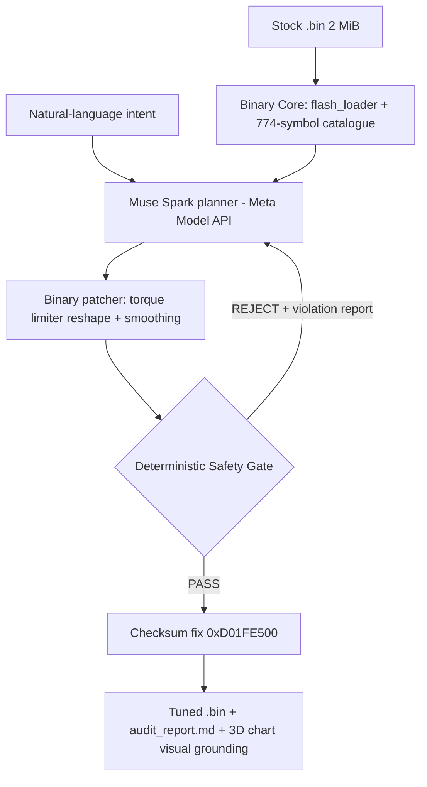

# MetaECU Copilot — Autonomous & Verifiable Calibration Engine


**AI proposes. Physics disposes.** MetaECU Copilot reads the real 2 MiB flash of a
Bosch EDC16C39 (Saab 9-3 1.9 TiD), lets Meta Muse plan a calibration from the
774-symbol Bosch catalogue, patches the binary — and then subjects every plan to a
deterministic Safety Gate. If Muse asks for 450 Nm, the Gate computes effective
torque (indicated − friction @ 90 °C), rejects it against the 377 Nm F40 clutch
limit, and Muse replans inside the physical envelope. Approved binaries ship with
a corrected Bosch checksum (`0xD01FE500`) and a full audit report.

## Hackathon Compliance & Original Contributions (Rules & Evidence)

In strict accordance with the **Meta Global AI Developer Hackathon Rules**:

- **New Work Only & Prior Codebase (Kai | CV ruling):** _"Your submitted repo must be a standalone extract from your existing project. Repo: A fresh repo containing only work done during the event. Keep your existing codebase out of it. Demo: Open your 3-minute video with one line stating what was pre-existing and what you built this week."_
  - **Pre-existing assets:** The raw binary dump (`SAAB 93 tid 2008 edc16c39 1037389375.Bin`) and static map catalogue (`BOSCH_EDC16C39_1037389375_COMPLETE_CATALOG.json`).
  - **Built entirely during the Hackathon (Oct 26 – Nov 4, 2026):** The autonomous Meta Muse reasoning planner (`backend/ai_engine/muse_planner.py`), binary patcher (`muse_patcher.py`), SAM 3.1 multimodal vision studio (`sam_vision_live.py`), the deterministic Safety Gate & self-correction loop (`backend/safety_engine/`), the interactive Web Cockpit (`web_app.py`, WebGL 3D, Web Audio synthesis), the native desktop wrapper (`run_desktop.py`, `build_exe.py`), and the cloud deployment pipeline (`modal_deploy.py`).
  - **Pristine Standalone Submission Repo:** Generated via `python tools/prepare_github_repo.py` into `dist/MetaECU-Copilot/` (clean, zero legacy history, ready for public GitHub).
- **Alignment with Meta Live Session — Agents 102 (Verifiable Agents by Yash Khare):**
  MetaECU Copilot directly implements the principles presented in the official Meta workshop _Agents 102: Best Practices for Verifiable Agents_. We demonstrate that LLM outputs in safety-critical cyber-physical systems must be verified against deterministic domain gates before actuation.

---

## Quick start

```bash
pip install -r requirements.txt
python main.py --intent "Give me 450 Nm, maximum power"   # CLI pipeline
python web_app.py                                        # Interactive Cockpit -> http://localhost:8000
python run_desktop.py                                    # Native desktop window, no console
```

## Try it live — no install

- **Live Product (Modal, public HTTPS):** deploy once with `modal deploy modal_deploy.py` (see `DEPLOYMENT.md`). Modal prints a public URL of the form `https://<your-workspace>--metaecu-copilot-web.modal.run` — that URL is the one pasted into the Cerebral Valley submission form. Judges open it and get the full cockpit instantly.
- **Windows desktop app:** `python build_exe.py` produces a single-file `dist/MetaECU_Copilot.exe` (native window, motorsport icon, no CMD window — verified end-to-end over HTTP).
- **Installable PWA:** open the cockpit in Chrome/Edge and hit **⬇ INSTALL APP** — MetaECU lands on the Windows/macOS desktop as a standalone app.

Full step-by-step: [`DEPLOYMENT.md`](DEPLOYMENT.md).

## Interactive Tuning Cockpit & SAM Vision Studio (`web_app.py`)

Futuristic dark motorsport cockpit (FastAPI + Tailwind + Plotly WebGL):

- **Drag & drop** the 2 MB stock `.bin` — instant ECU fingerprint (Bosch EDC16C39, SW 1037389375, checksum `0xD01FE500`, 774 catalogue symbols).
- **Interactive 3D map explorer** (rotate/zoom): `EngPrt_trqLim_CUR`, `EngM_trqFrc_MAP`, `Rail_pSetPointBase_MAP`, `PCR_pDesBas_MAP` (boost), SOI and smoke maps — stock vs after tuning.
- **AI Thought Stream**: live SSE feed of Muse planning and every Safety Gate event.
- **Safety Gate Intercept HUD**: an aggressive "450 Nm" request triggers the pulsing red `CRITICAL SAFETY INTERCEPT: F40 CLUTCH AT RISK` alarm, the overload zone on the torque chart, and the automatic self-correction to a gate-approved calibration.
- **SAM 3.1 Vision Studio**: upload a dyno chart screenshot — Meta Vision (with deterministic numeric fallback) grounds the curves, finds the torque dip and recommends a correction.
- **Road telemetry**: the real v8/v9/v10 OBD road logs (33 WOT pulls), RPM/boost/rail/MAF series and the audited spool comparison (v9 4.90 s → v10 1.34 s to 1.40 bar).
- **Voice intent**: browser microphone (Web Speech API, PL/EN) or an uploaded voice note → Muse translates it into a calibration intent.
- **Flash & Export**: download the gate-approved `.bin` (checksum re-verified `0xD01FE500`) and the Markdown audit report.
- **Motorsport audio FX** (pure Web Audio synthesis, no files): turbo spool-up on binary drop, pulsing overload alarm on the Safety Gate intercept, automotive relay click + confirmation chime on PASS — with a mute toggle in the header.
- **Runs everywhere**: browser tab, installable PWA, native Windows `.exe`, or public Modal HTTPS — see `DEPLOYMENT.md`.

## Architecture



## Verification

```bash
python backend/binary_core/test_binary_core.py   # 17 checks on the real stock binary
python backend/test_end_to_end.py                # gate + self-correction loop (offline)
python backend/test_meta_api.py                  # live Meta Model API check
```

Demo: see `demo_assets/DEMO_SCRIPT.md` (second-by-second 3-minute script) and
regenerate all recording artifacts with `python demo_assets/generate_demo_assets.py`.

---

> The multi-vehicle repository overview (Saab, Audi, Lancer, OpenTune Studio)
> remains in the sections below.

# Multi-Vehicle ChipTuning Master Repository

Inżynieryjne repozytorium wsadowe, definicyjne i audytowe dla projektów modyfikacji sterowników silnika (ECU Remapping & Calibration Engineering).

Każdy pojazd posiada dedykowany, całkowicie samowystarczalny obszar roboczy (Workspace) z kompletem plików seryjnych, modyfikowanych, definicji XDF, narzędzi sum kontrolnych, skryptów testowych oraz dokumentacji technicznej.

---

## 🗂️ Aktywne projekty pojazdów (Workspaces)

### 0. [00_TOP10_CHIPTUNING_PLATFORMS/](00_TOP10_CHIPTUNING_PLATFORMS/)

- **Przeznaczenie:** Reprezentatywna baza danych i analiza wykonalności biznesowej dla 10 najczęściej modyfikowanych platform silnikowych (Benchmark & Feasibility Study).
- **Zawartość pakietu:** 27 zweryfikowanych plików (66.98 MB), w tym oryginalne odczyty Flash (`.ori`, `.bin`), oficjalne projekty WinOLS (`.ols`, `.kp`), definicje ASAP2 DAMOS (`.a2l`) oraz definicje TunerPro (`.xdf`).
- **Platformy objęte badaniem:**
  1. `01_VAG_1.9TDI_PD_EDC15P/` — VW Golf 4, Passat B5.5, Audi A3 (ASZ/ARL 130-150 KM)
  2. `02_VAG_1.9TDI_PD_EDC16U34/` — VW Passat B6, Golf 5 (BKC/BXE/BLS 105 KM)
  3. `03_BMW_3.0D_M57_EDC15C4/` — BMW E46 330d, E39 530d M57 (184-193 KM)
  4. `04_BMW_3.0D_M57_N57_EDC17CP09/` — BMW E90 330d/335d, E70 X5 35d (231-286 KM)
  5. `05_VAG_2.0TSI_EA888_SIMOS18/` — VW Golf 7 GTI/R, Audi S3 8V (220-310 KM)
  6. `06_BMW_3.0T_N54_MSD80/` — BMW 135i, 335i, 535i E90/E92 N54 BiTurbo (306 KM)
  7. `07_BMW_3.0T_B58_MG1CS003/` — BMW 340i, M140i, M340i, Toyota GR Supra (326-374 KM)
  8. `08_VAG_2.7T_V6_ME71/` — Audi S4 B5, A6 C5 2.7T V6 BiTurbo 30V (250-265 KM)
  9. `09_BMW_3.0I_M54_MS43/` — BMW E46 330i, E39 530i, E53 X5 3.0i M54 (231 KM)
  10. `10_ALFA_2.0TS_TURBO_ME/` — Alfa Romeo GTV 2.0 V6 Turbo, 145/155 2.0 Twin Spark
- **Raport rynkowy:** Szczegółowa analiza barier wejścia, kryptografii HSM/Secure Boot, ekonomii serwisów typu File Service oraz kalkulacja rentowności modelu hybrydowego w pliku `00_TOP10_CHIPTUNING_PLATFORMS/README.md`.

---

### 1. [01_SAAB_9-3_1.9TID_EDC16C39/](01_SAAB_9-3_1.9TID_EDC16C39/)

- **Pojazd:** Saab 9-3 II FL (2008), 1.9 TiD 16V (Z19DTH), skrzynia manualna 6b F40
- **Sterownik ECU:** Bosch EDC16C39 (HW: `0281014551`, SW: `1037389375`, procesor Motorola MPC562)
- **Pakiet kalibracyjny:** Stage 1+ Dynamic (200 KM / 410 Nm, 0% dymu, EGR off, deaktywacja czujnika wody w filtrze)
- **Wersje:**
  - `01_WSAD_STAGE1_V7/` — Wsad bazowy zweryfikowany fizycznie (201.1 KM / 422 Nm, suma 32-bit `0xD01FE500`)
  - `01_WSAD_STAGE1_V8_EXTENDED_FEATURES/` — Wersja z optymalizacją SOI na autostradzie, twardą odciną Popcorn 4700 rpm i dwuprofilowym pedałem gazu
  - `01_WSAD_STAGE1_V9_EXTENDED_FEATURES/` — Wsad v9 Extended S1-Enhanced (profil pedału S1-Enhanced z dawkami ze starego S1, Hardcut 4700 rpm, Cruising SOI, telemetria 17 prób WOT: 201–203 KM, 376.5 Nm na sprzęgle F40, stabilny boost 1.46–1.52 bar, MIL = 0.0 km)
  - `01_WSAD_STAGE1_V10_EXTENDED_FEATURES/` — Wsad docelowy v10 Extended Spool & Punch (odblokowany limiter dymienia FlMng 1750–2500 rpm, przymknięcie VNT N75 +1.0–2.6%, wyostrzony środek 415–423 Nm z ochroną dwumasy 1500 rpm; telemetria 33 prób WOT: 1.40 bar na 4. biegu w 1.34 s vs 4.90 s w v9, 202.5 KM / 414 Nm, MIL = 0.0 km)
- **Struktura pomocnicza:** `02_PLIKI_SERYJNE_I_BAZOWE/`, `03_DEFINICJE_MAP_XDF/` (774 mapy DAMOS), `04_SKRYPTY_AUDYTOW_I_TESTOW/`, `05_ARCHIWUM_I_ZRODLA/`

---

### 2. [02_AUDI_A4_1.8T_ME75/](02_AUDI_A4_1.8T_ME75/)

- **Pojazd:** Audi A4 B5/B6 Quattro, manualna skrzynia biegów
- **Silnik:** 1.8T 20V AWT (seryjnie 150 KM / 210 Nm, CR 9.3:1)
- **Sterownik ECU:** Bosch Motronic ME7.5 (HW: `0261207928`, SW: `1037366497`, VAG: `4B0906018DH`, wersja SW: `0004`, mikroprocesor Infineon C167CR)
- **Konfiguracja osprzętu (Stage 3):**
  - Kute korbowody 4340 H-beam ze sworzniem 20 mm i śrubami ARP 2000 (wytrzymałość 550+ Nm)
  - Zestaw sprzęgła ze sztywnym jednomasowym kołem 240 mm i tarczą obitą kevlarem (limit 550–650 Nm)
  - Regulator ciśnienia paliwa FPR 4.0 bar na listwie (wydatek wtryskiwaczy Bosch EV14: 606.2 cc/min, stała `KRKTE = 293`)
  - Turbosprężarka Mitsubishi TD04HL-16T z siłownikiem wastegate 0.60 bar bazowego
  - Głowica small-port AWT na seryjnych wałkach rozrządu AWT oraz wydech przelotowy 3 cale (Downpipe 3")
  - Doładowanie szczytowe 1.45–1.50 bar (195% rl) z łagodnym zejściem do 165% przy 6700 rpm (oczekiwane 305–315 KM, 420–440 Nm)
- **Struktura modułowa:**
  - `01_SERIA_OEM/` — 100% fabryczny odczyt Flash 1 MB (`Audi A4 1.8T AWT 4B0906018DH 0261207928 366497.ori`, CRC32: `0x3FD5ED14`)
  - `02_WSAD_STAGE3/` — Wsad docelowy Stage 3 Pb98 (`AUDI_A4_18T_AWT_4B0906018DH_STAGE3_525CC_TD04HL_CS_OK.bin`) oraz bezpieczny wsad testowy/docieranie 95 RON (`AUDI_A4_18T_AWT_4B0906018DH_STAGE3_SAFE_LOWBOOST_95RON_CS_OK.bin`) z weryfikacją ME7Check (0 błędów, 11/11 sum skorygowanych przez `me7sum.exe`)
  - `03_IMMO_OFF_EEPROM/` — Gotowy szablon Immo OFF 512 B ST95040 (`AUDI_ME75_ST95040_IMMO_OFF_TEMPLATE.bin`) + generator sum kontrolnych stron `me7_eeprom_immo_off.py`
  - `04_DEFINICJE_XDF/` — Dedykowana definicja map TunerPro (`AUDI_A4_18T_AWT_4B0906018DH_0004.xdf`) z kluczowymi mapami i stałymi oraz nazewnictwem inżynieryjnym DE/EN/PL
  - `05_NARZEDZIA_I_BINARKI/` — Narzędzia binarne `ME7Check.exe` i `me7sum.exe`
  - `06_DOKUMENTACJA_I_DAMOS/` — Baza referencyjna A2L/HEX (`ME7.5.a2l`), sygnatury needle-search i narzędzia analizy ME7

---

### 3. [03_MITSUBISHI_LANCER_1.8_MELCO_E6T72373/](03_MITSUBISHI_LANCER_1.8_MELCO_E6T72373/)

- **Pojazd:** Mitsubishi Lancer VIII (CY3A), Sedan 2008, manualna skrzynia biegów 5b
- **Silnik:** 1.8 DOHC 16V Dual MIVEC (kod silnika `4B10`, seryjnie 143 KM / 178 Nm, CR 10.5:1, MPI)
- **Sterownik ECU:** Mitsubishi Electric (Melco) `E6T72373` / `E6T72373H` (OEM: `1860A976`)
- **Oprogramowanie i procesor:**
  - Kalibracja / SW: `1860A97602` (`1860A9760201`), kod bazowy ROM: `SM5250` (ROM ID: `52500012`)
  - Suma weryfikacji kalibracji (CVN): `01EFA5A2C2`
  - Mikrokontroler: Renesas / Mitsubishi `MH8106F` (1024 KB Flash CAN-bus, 500 kbaud, ID: 7E8)
- **Status telemetryczny serii OEM (Log drogowy 2026-10-19):**
  - Korekty paliwowe: Długoterminowa LTFT: -0.73%, Krótkoterminowa STFT: +1.84% (wzorowa adaptacja, absolutny brak nieszczelności i lewego powietrza)
  - Podciśnienie MAP na biegu jałowym: 31.8 kPa; przy WOT: 104 kPa (zero dławienia w puszce dolotowej)
  - Przepływomierz MAF: 1.94 g/s na biegu jałowym (650 rpm), maksymalnie 89.34 g/s przy 5113 rpm
  - Brak aktywnych błędów DTC (MIL = 0.0 km od 12 550 km), katalizator i sondy O2 w 100% sprawne
- **Struktura modułowa:**
  - `01_LOGI_I_DIAGNOSTYKA/` — Surowy log drogowy `2026-10-19_15-32-28_SERIA_OEM.csv` (10 728 wierszy)
  - `02_SERIA_OEM/` — Przestrzeń na zrzut binarny Flash 1 MB (`.bin` / `.srf`)
  - `03_DEFINICJE_MAP_XML_XDF/` — Wzorce definicji EcuFlash XML (`52500012_SM5250_Lancer_18_4B10.xml`)
  - `04_SKRYPTY_ANALIZY/` — Zautomatyzowany parser i audytor telemetryczny `analyze_lancer_logs.py`
  - `05_DOKUMENTACJA_I_PINOUT/` — Schematy połączeń OBD-II / CAN i procedury PCMflash (Moduł 24)

---

### 4. [04_OPENTUNE_STUDIO/](04_OPENTUNE_STUDIO/)

- **Przeznaczenie:** Otwarta platforma telemetrii, diagnostyki i walidacji tuningu (OBD-II / UDS / KWP) — rdzeń pomiarowy, CLI, symulator ECU i pipeline analityczny.
- **Status:** v0.1.0 — działający rdzeń, 93 testy, walidacja na realnym logu Saab 9-3 1.9 TiD (203,2 KM / 455 Nm vs raport projektu 202,5 KM / 414 Nm na sprzęgle).
- **Możliwości:**
  - Transporty: serial USB / Bluetooth SPP, TCP Wi-Fi, symulator ELM327, fundament raw CAN.
  - Protokoły: ELM327, OBD-II (50+ PID, Mode 09), DTC, ISO-TP, UDS z bramkami bezpieczeństwa.
  - Profile pojazdów w YAML (generyczny + Saab 9-3 Z19DTH, Audi A4 1.8T ME7.5, Lancer 1.8 4B10) + szablon.
  - Logowanie sesji: CSV + `meta.json` + `events.jsonl` z hashem profilu, VIN i statystykami łącza.
  - Import logów Car Scanner Pro (normalizacja nagłówków PL, odrzucanie agregatów).
  - Analiza: statystyki, bramki zdrowia (progi per profil), road dyno z modelem fizycznym i niepewnością.
- **Dokumentacja:** [README](04_OPENTUNE_STUDIO/README.md) + 7 dokumentów inżynierskich (research OSS, architektura, protokoły, hardware, workflow tuningu, roadmapa, bezpieczeństwo/prawo).
- **Zastrzeżenie:** narzędzie **nie** flashuje ECU przez ELM327 — przygotowuje pomiar, manifest i weryfikację; zapis wykonują narzędzia J2534/bench.

---

### 5. [05_AUDI_A3_1.9TDI_ALH_EDC15V/](05_AUDI_A3_1.9TDI_ALH_EDC15V/)

- **Pojazd:** Audi A3 8L 1.9 TDI 8V (Zielone Mateusza)
- **Silnik:** 1.9 TDI ALH (pompa wtryskowa Bosch VP37, seryjnie 90 KM / 210 Nm)
- **Sterownik ECU:** Bosch EDC15V / EDC15VM+2.V1 (HW: `0281010122`, SW: `1037350850`, VAG: `038906012C`, kalibracja: `2803`, SW Ver: `28SA4204`)
- **Struktura wielobankowa:**
  - Bank 1 (Manual - SG): Zmodyfikowany wsad w aucie (`0x57000 - 0x64000`)
  - Bank 2 (Auto - AG, offset `+0x18000`): W 100% nienaruszona seria OEM (`0x6F000 - 0x7C000`)
- **Pomiary telemetryczne (Log drogowy z 2026-10-26, 7 prób WOT):**
  - Moc silnika: **~170 – 180 KM** (wzrost z 90 KM o +95%)
  - Moment obrotowy: **~380 – 410 Nm** (wzrost z 210 Nm o +90%)
  - Zmierzone doładowanie: **1.54+ bar (255 kPa)** (zacięty limit seryjnego czujnika MAP)
  - Kąt wyprzedzenia wtrysku: do **16.5° BTDC** @ 4000 RPM (zgodny z mapą SOI `0x6130A`)
- **Kluczowe ustalenia audytowe:**
  - Wykryto kalibrację pompy VP37 (`PUMPENSPANNUNG`) obniżoną o ~20% w part-load, co jednoznacznie potwierdza **montaż większych wtryskiwaczy (np. 0.216 mm / 216 lub 0.230 mm)**.
  - Wykryto błąd tunera w wyłączeniu EGR: mapa `0x5983C` została zalana zerami (w EDC15 to żądana masa świeżego powietrza, co zmusza zawór EGR do 100% otwarcia).
  - Wykryto żądanie doładowania 2850 mbar przy seryjnym czujniku MAP kończącym się na 2500 mbar (sterownik powyżej 1.54 bar jedzie na ślepo).
- **Struktura workspace:** `01_SERIA_OEM_I_WSAD_AKTUALNY/`, `02_LOGI_DYNAMICZNE/`, `03_DEFINICJE_MAP_XDF/`, `04_DOKUMENTACJA_I_DAMOS/`.

---

## 🛠️ Standardy inżynierskie w repozytorium

1. **Izolacja projektów:** Każdy folder pojazdu stanowi niezależny mikro-projekt z własnym plikiem `README.md`, skryptami budującymi oraz suitą testową `verify_*.py`.
2. **Ścieżki względne:** Wszystkie skrypty Pythona bazują na `Path(__file__).resolve().parent`, co pozwala na ich uruchamianie z dowolnego poziomu bez zależności od twardych ścieżek systemowych.
3. **Integralność sum kontrolnych (Zero-Tolerance):** Żaden plik zmodyfikowany nie jest dopuszczany do programowania bez zweryfikowania sum kontrolnych oficjalnymi narzędziami walidacyjnymi (np. `ME7Check` dla ME7.5, sumator 32-bit dla EDC16).
4. **Nienaruszalność kodu wykonywalnego:** Zmiany obejmują wyłącznie kalibrację w zidentyfikowanych blokach map. Kod sterujący procesora pozostaje nienaruszony.

---

## 🔍 Pozyskiwanie definicji map i dokumentacji dla nowych pojazdów (Workflow)

Gdy do repozytorium dołączany jest nowy model pojazdu lub nowa rodzina sterownika, proces pozyskiwania i weryfikacji definicji opiera się na 4 krokach:

### 1. Zbieranie identyfikatorów z odczytu ECU

Przed rozpoczęciem poszukiwań w sieci należy wyodrębnić z pamięci sterownika (lub etykiety obudowy) komplet parametrów identyfikacyjnych:

- **Numer sprzętowy producenta ECU (HW):** np. Bosch `0 281 014 551`, `0 261 207 215`.
- **Wersja oprogramowania (SW / Software ID):** 10-cyfrowy ciąg Boscha, np. `1037389375`, `1037360306`.
- **Numer części producenta pojazdu (OEM Part Number):** np. VAG `4B0 906 018 CG`, GM/Saab `55568886`.
- **Architektura procesora i pamięci:** np. Motorola MPC562 (Flash 2 MB), Infineon C167CR / AMD 29F800 (Flash 1 MB), Infineon TriCore TC1796/TC1797 (Flash 2-4 MB).
- **Identyfikator kompilacji (EPK / Version String):** np. `40/1/ME7.5/5/4016.31//24b/Dst02o/290900//`.

### 2. Czego szukać w sieci (Typy plików i artefaktów)

- **Pliki A2L / ASAP2 (`.a2l`):** Standaryzowany format opisu pamięci (ASAM MCD-2MC). Najbardziej wartościowe źródło wiedzy: zawiera oryginalne nazwy modułów i symboli Boscha/Siemensa, adresy, typy danych, osie oraz współczynniki konwersji fizycznej (`COMPU_METHOD`, `COEFFS`).
- **Pakiety projektowe DAMOS / WinOLS (`.damos`, `.ols`, `.kp`):** Gotowe bazy zdefiniowanych map pod konkretny numer oprogramowania. Pliki `.kp` zawierają spakowane definicje tabel, osi i offsetów.
- **Definicje TunerPro (`.xdf`):** Tekstowe pliki XML definiujące tabele, osie i formuły matematyczne dla TunerPro V5.
- **Funktionsrahmen (FR / Dokumentacja logiczna ECU w PDF):** Fabryczne schematy blokowe algorytmów sterownika (np. Funktionsrahmen Bosch ME7.5, EDC16, EDC17). Opisują matematyczne relacje między mapami (np. jak żądanie momentu z pedału gazu przechodzi przez ograniczniki dymienia i ochrony silnika).
- **Fabryczne pliki odczytu Flash (`.ori` / `.bin`):** Czyste, niemodyfikowane pliki referencyjne z innych pojazdów tej samej rodziny, służące do porównań różnicowych.

### 3. Sprawdzone źródła i społeczności inżynieryjne

1. **Nefarious Motorsports (NefMoto):** `nefmoto.com`
   - Główne centrum wiedzy dla benzynowych sterowników Bosch Motronic ME7.x (silniki 1.8T, 2.7T, 4.2 V8).
   - Dostępne definicje XDF, sygnatury kodu maszynowego C167, kalkulatory sum kontrolnych (`me7check`, `me7sum`) oraz narzędzia do pamięci EEPROM (`me7_eeprom`).
2. **TrionicTuning:** `trionictuning.com`
   - Specjalistyczne forum dla pojazdów Saab i Opel (Bosch EDC16C39, ME9.6, systemy Saab Trionic T5/T7/T8).
   - Baza mappacków WinOLS tworzonych przez inżynierów (m.in. Mackan), dekompilatory i definicje map.
3. **ECUConnections:** `ecuconnections.com`
   - Największa międzynarodowa baza wymiany plików A2L, DAMOS, projektów WinOLS i oryginalnych wsadów ORI dla sterowników europejskich, azjatyckich i amerykańskich (Bosch EDC15/16/17, MED9/17, Siemens SID, Delphi, Denso).
4. **S4Wiki (ME7 Tuning Wiki):** `s4wiki.com`
   - Kompletna dokumentacja inżynieryjna modeli fizycznych Bosch ME7: model momentu, napełnienie cylindra, korekcja lambda, regulacja doładowania PID i zabezpieczenia stukowe.
5. **Repozytoria GitHub:**
   - Otwarte narzędzia analityczne: parsery plików A2L/ASAP2 w Pythonie, deasemblery C167/TriCore, kalkulatory sum kontrolnych.

### 4. Metoda postępowania przy braku bezpośredniego DAMOS (Cross-Referencing)

Gdy dla danego numeru SW nie ma gotowego pliku DAMOS:

1. Pobierz plik A2L lub projekt KP z pokrewnego oprogramowania tej samej rodziny sterownika (np. pokrewny wariant silnika 1.9 CDTI/TiD lub 1.8T).
2. Wykorzystaj technikę wyszukiwania wzorców maszynowych (Needle-Search / Pattern Matching): zidentyfikuj charakterystyczne sekwencje bajtów nagłówków map, siatki osi oraz wywołania podprogramów interpolacji.
3. Wyodrębnij nazwy parametrów, jednostki i formuły przeliczeniowe z referencyjnego A2L, a następnie przelicz rzeczywiste adresy wskaźników dla nowego wsadu.
4. Zbuduj dedykowany generator wsadu (`build_*.py`), definicję (`.xdf`) oraz skrypt weryfikacji fizycznej (`verify_*.py`), sprawdzając integralność sum kontrolnych przed jakimkolwiek zapisem do pamięci sterownika.
