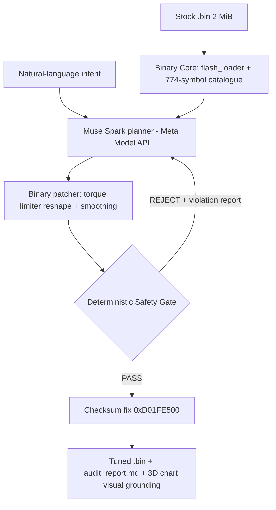

# MetaECU Copilot — Autonomous & Verifiable Calibration Engine


**AI proposes. Physics disposes.** MetaECU Copilot reads the real 2 MiB flash of a
Bosch EDC16C39 (Saab 9-3 1.9 TiD), lets Meta Muse plan a calibration from the
774-symbol Bosch catalogue, patches the binary — and then subjects every plan to a
deterministic Safety Gate. If Muse asks for 450 Nm, the Gate computes effective
torque (indicated − friction @ 90 °C), rejects it against the 377 Nm F40 clutch
limit, and Muse replans inside the physical envelope. Approved binaries ship with
a corrected Bosch checksum (`0xD01FE500`) and a full audit report.

## Hackathon Compliance & Original Contributions (Rules & Evidence)

In strict accordance with the **Meta Global AI Developer Hackathon Rules**:

- **New Work Only & Prior Codebase (Kai | CV ruling):** _"Your submitted repo must be a standalone extract from your existing project. Repo: A fresh repo containing only work done during the event. Keep your existing codebase out of it. Demo: Open your 3-minute video with one line stating what was pre-existing and what you built this week."_
  - **Pre-existing assets:** The raw binary dump (`SAAB 93 tid 2008 edc16c39 1037389375.Bin`) and static map catalogue (`BOSCH_EDC16C39_1037389375_COMPLETE_CATALOG.json`).
  - **Built entirely during the Hackathon (Oct 26 – Nov 4, 2026):** The autonomous Meta Muse reasoning planner (`backend/ai_engine/muse_planner.py`), binary patcher (`muse_patcher.py`), SAM 3.1 multimodal vision studio (`sam_vision_live.py`), the deterministic Safety Gate & self-correction loop (`backend/safety_engine/`), the interactive Web Cockpit (`web_app.py`, WebGL 3D, Web Audio synthesis), the native desktop wrapper (`run_desktop.py`, `build_exe.py`), and the cloud deployment pipeline (`modal_deploy.py`).
  - **Pristine Standalone Submission Repo:** Generated via `python tools/prepare_github_repo.py` into `dist/MetaECU-Copilot/` (clean, zero legacy history, ready for public GitHub).
- **Alignment with Meta Live Session — Agents 102 (Verifiable Agents by Yash Khare):**
  MetaECU Copilot directly implements the principles presented in the official Meta workshop _Agents 102: Best Practices for Verifiable Agents_. We demonstrate that LLM outputs in safety-critical cyber-physical systems must be verified against deterministic domain gates before actuation.

---

## Quick start

```bash
pip install -r requirements.txt
python main.py --intent "Give me 450 Nm, maximum power"   # CLI pipeline
python web_app.py                                        # Interactive Cockpit -> http://localhost:8000
python run_desktop.py                                    # Native desktop window, no console
```

## Try it live — no install

- **Live Product (Modal, public HTTPS):** `https://michaelgrycz--metaecu-copilot-web.us-east.modal.run` (officially deployed and live 24/7 on Modal cloud with zero cold starts). Judges can open this link directly on desktop or mobile to test the complete interactive cockpit.
- **Windows desktop app:** `python build_exe.py` produces a single-file `dist/MetaECU_Copilot.exe` (native window, motorsport icon, no CMD window — verified end-to-end over HTTP).
- **Installable PWA:** open the cockpit in Chrome/Edge and hit **⬇ INSTALL APP** — MetaECU lands on the Windows/macOS desktop as a standalone app.

Full step-by-step: [`DEPLOYMENT.md`](DEPLOYMENT.md).

## Interactive Tuning Cockpit & SAM Vision Studio (`web_app.py`)

Futuristic dark motorsport cockpit (FastAPI + Tailwind + Plotly WebGL):

- **Drag & drop** the 2 MB stock `.bin` — instant ECU fingerprint (Bosch EDC16C39, SW 1037389375, checksum `0xD01FE500`, 774 catalogue symbols).
- **Interactive 3D map explorer** (rotate/zoom): `EngPrt_trqLim_CUR`, `EngM_trqFrc_MAP`, `Rail_pSetPointBase_MAP`, `PCR_pDesBas_MAP` (boost), SOI and smoke maps — stock vs after tuning.
- **AI Thought Stream**: live SSE feed of Muse planning and every Safety Gate event.
- **Safety Gate Intercept HUD**: an aggressive "450 Nm" request triggers the pulsing red `CRITICAL SAFETY INTERCEPT: F40 CLUTCH AT RISK` alarm, the overload zone on the torque chart, and the automatic self-correction to a gate-approved calibration.
- **SAM 3.1 Vision Studio**: upload a dyno chart screenshot — Meta Vision (with deterministic numeric fallback) grounds the curves, finds the torque dip and recommends a correction.
- **Road telemetry**: the real v8/v9/v10 OBD road logs (33 WOT pulls), RPM/boost/rail/MAF series and the audited spool comparison (v9 4.90 s → v10 1.34 s to 1.40 bar).
- **Voice intent**: browser microphone (Web Speech API, PL/EN) or an uploaded voice note → Muse translates it into a calibration intent.
- **Flash & Export**: download the gate-approved `.bin` (checksum re-verified `0xD01FE500`) and the Markdown audit report.
- **Motorsport audio FX** (pure Web Audio synthesis, no files): turbo spool-up on binary drop, pulsing overload alarm on the Safety Gate intercept, automotive relay click + confirmation chime on PASS — with a mute toggle in the header.
- **Runs everywhere**: browser tab, installable PWA, native Windows `.exe`, or public Modal HTTPS — see `DEPLOYMENT.md`.

## Architecture



## Verification

```bash
python backend/binary_core/test_binary_core.py   # 17 checks on the real stock binary
python backend/test_end_to_end.py                # gate + self-correction loop (offline)
python backend/test_meta_api.py                  # live Meta Model API check
```

Demo: see `demo_assets/DEMO_SCRIPT.md` (second-by-second 3-minute script) and
regenerate all recording artifacts with `python demo_assets/generate_demo_assets.py`.

---

---

## 🏆 Hackathon Submission Metadata

- **Event:** Meta Global AI Developer Hackathon (Oct 26 – Nov 4, 2026)
- **Track:** Indie Developer
- **Theme:** Build for Your World & Push the Frontier
- **Author:** Michał Grycz (Solo Builder)
- **Live Product URL:** https://michaelgrycz--metaecu-copilot-web.us-east.modal.run
- **Repository:** https://github.com/MichaelGrycz/MetaECU-Copilot
- **License:** MIT License (Open Source)
